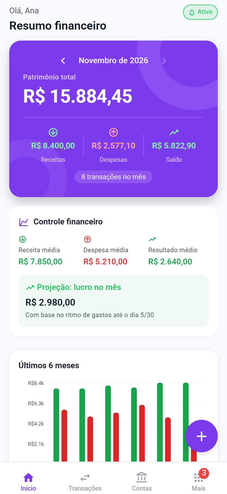
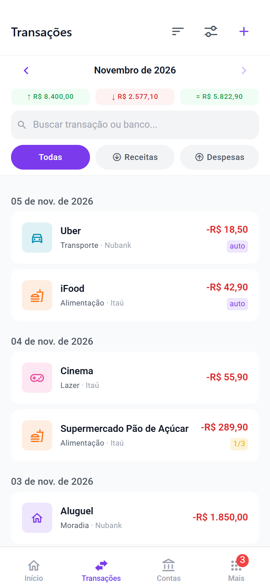
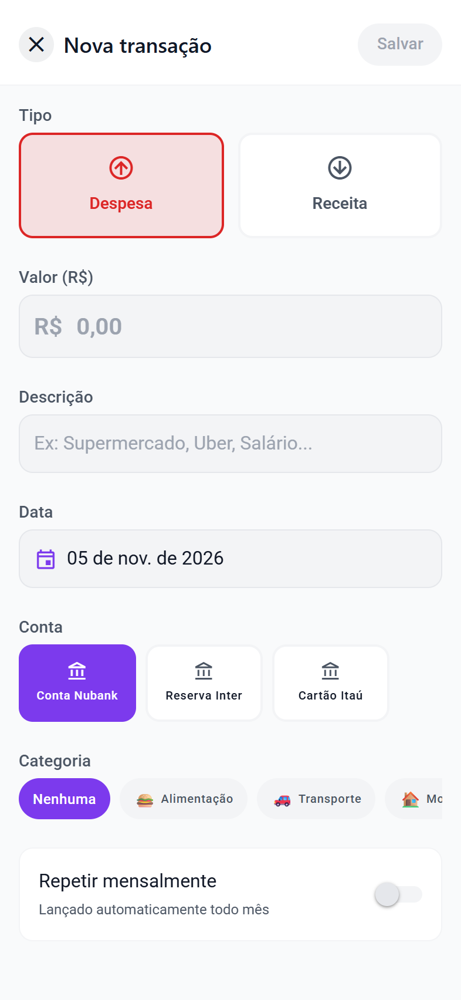
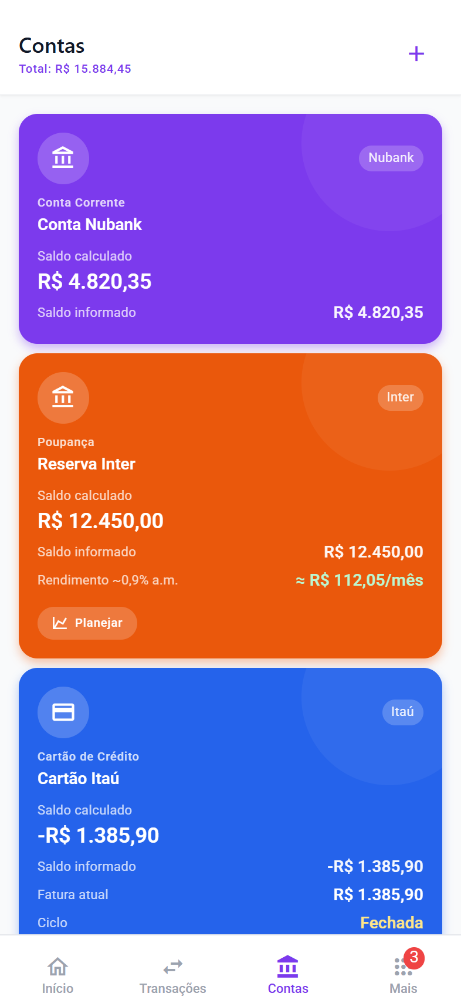
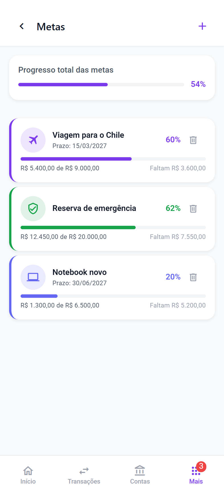
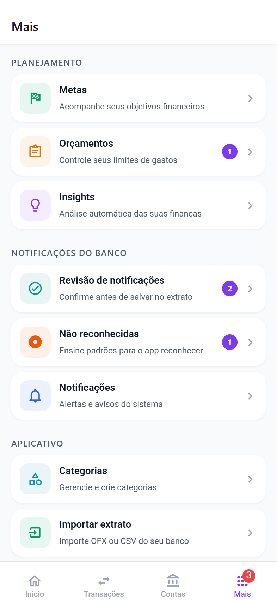
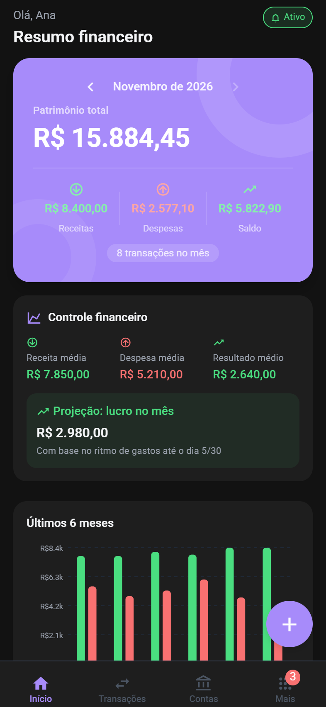
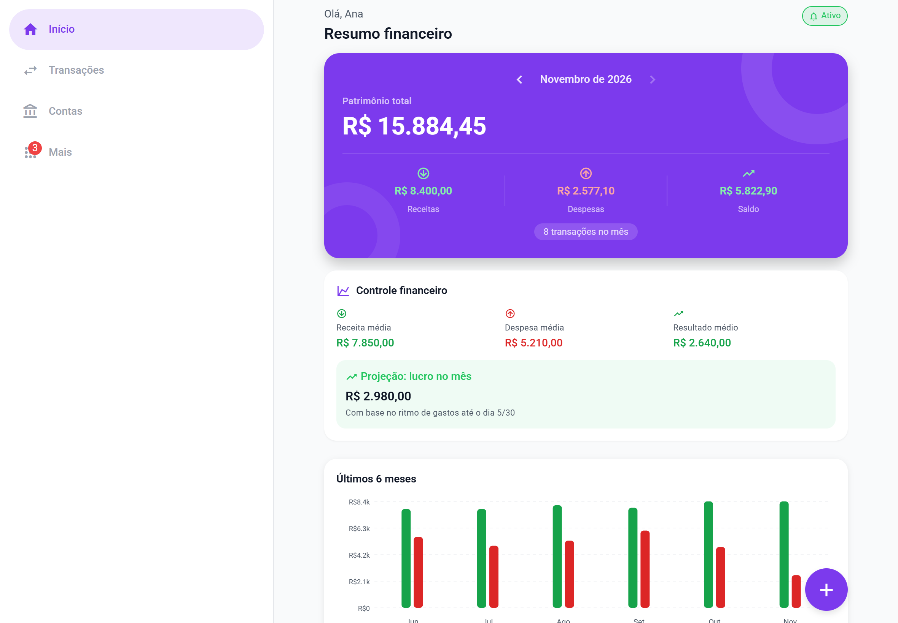

# FinTrack — Monitor Financeiro Inteligente

App Android nativo em React Native que monitora automaticamente suas finanças via notificações bancárias.

## Prévias

<table>
  <tr>
    <td align="center"><br><sub>Início</sub></td>
    <td align="center"><br><sub>Transações</sub></td>
    <td align="center"><br><sub>Nova transação</sub></td>
    <td align="center"><br><sub>Contas</sub></td>
  </tr>
  <tr>
    <td align="center"><br><sub>Metas</sub></td>
    <td align="center"><br><sub>Mais</sub></td>
    <td align="center"><br><sub>Tema escuro</sub></td>
    <td></td>
  </tr>
</table>

<p align="center">
  <br>
  <sub>Tablet e modo paisagem: navegação lateral e conteúdo centralizado</sub>
</p>

> Telas renderizadas a partir do código do app (versão 1.0.6) com dados de demonstração.

## Android e iOS

O monitoramento automático só existe no **Android**: é lá que o app pode ler as notificações dos apps de banco. O **iOS não permite** que um app leia notificações de outros apps, então no iPhone o FinTrack funciona apenas com lançamentos manuais e importação de extratos (OFX/CSV). O onboarding avisa isso no iOS.

## Seus dados

Tudo fica no SQLite do próprio celular; o app só acessa a internet para procurar atualizações no GitHub.

- **Backup completo:** em *Mais → Configurações → Backup e Segurança → Fazer backup*, o app gera um arquivo JSON com contas, transações, categorias, metas, orçamentos, padrões ensinados e preferências, e abre o compartilhamento do Android para salvar onde você quiser (Drive, Arquivos...).
- **Restaurar:** no mesmo menu, ou já na primeira tela do onboarding, escolha o arquivo do backup. Os dados do aparelho são substituídos pelos do backup.
- **Bloqueio do app:** em *Backup e Segurança*, ative o bloqueio para pedir digital, rosto ou o PIN do aparelho ao abrir o app e ao voltar para ele depois de um minuto fora.

## Como funciona

1. O app solicita permissão de **Acesso a Notificações** do Android
2. Quando chega uma notificação do seu banco (Nubank, Inter, Itaú, etc.), o `NotificationListenerService` a captura
3. O parser identifica o tipo de transação, valor e banco
4. A transação é registrada automaticamente no banco SQLite local

## Stack

| Camada | Tecnologia |
|---|---|
| Framework | React Native CLI 0.86 |
| Linguagem | TypeScript |
| Navegação | React Navigation 7 |
| Estado | Zustand 5 |
| Banco local | SQLite (react-native-sqlite-storage) |
| Preferências | AsyncStorage |
| UI | React Native Paper + componentes customizados |
| Animações | Reanimated 4 + Gesture Handler |
| Nativo Android | NotificationListenerService (Java) |

## Bancos suportados

- Nubank
- Banco Inter
- Itaú
- Bradesco
- Banco do Brasil
- Santander
- C6 Bank
- Caixa Econômica
- Mercado Pago
- PicPay
- Next, Neon, PagBank, Original e outros

## Estrutura do projeto

```
src/
├── models/         # Tipos TypeScript (tipos de domínio)
├── theme/          # Cores, tipografia, tema claro/escuro
├── database/
│   ├── db.ts                  # Inicialização SQLite + migrations
│   └── repositories/          # CRUD por entidade
├── store/          # Stores Zustand (estado global)
├── services/       # InsightService, ExportService
├── navigation/     # Configuração do React Navigation
├── hooks/          # useTheme e outros hooks
├── components/     # MetricCard, TransactionItem, AccountCard
├── utils/          # currency.ts, date.ts
├── constants/      # banks.ts
└── modules/
    ├── dashboard/
    ├── transactions/
    ├── accounts/
    ├── notifications/
    │   ├── parsers/    # Parser por banco (Nubank, Inter, Itaú...)
    │   ├── services/   # BankRegistry, NotificationParser
    │   └── hooks/      # useNotificationListener
    ├── goals/
    ├── budget/
    ├── insights/
    ├── settings/
    └── onboarding/

android/
└── app/src/main/java/com/fintrackapp/notification/
    ├── FinTrackNotificationService.java  # Serviço nativo Android
    ├── NotificationModule.java           # Bridge React Native ↔ Java
    └── NotificationPackage.java          # Registro do módulo
```

## Como executar

### Pré-requisitos
- Android Studio instalado
- JDK 17+
- Android SDK 34+
- Emulador ou dispositivo físico

### Instalação

```bash
# Instalar dependências
npm install

# Executar no Android
npx react-native run-android
```

### Permissão de Notificações

1. Abra o app e siga o onboarding
2. Toque em "Conceder acesso às notificações"
3. Na tela de Configurações do Android, ative o FinTrack
4. Volte ao app

## Adicionando suporte a novos bancos

1. Crie um parser em `src/modules/notifications/parsers/NovoBancoParser.ts`
2. Implemente a interface `BankParser` com o método `parse(title, body, packageName)`
3. Registre no `BankRegistry.ts` com o `packageName` correto
4. Adicione o `packageName` no array `BANK_PACKAGES` em `FinTrackNotificationService.java`

## Arquitetura do parser

```
Notificação Android
       ↓
FinTrackNotificationService.java (nativo)
       ↓ emit evento
NotificationModule.java (bridge)
       ↓ NativeEventEmitter
useNotificationListener.ts (React Native)
       ↓
NotificationParser.ts
       ↓ lookup packageName
BankRegistry.ts
       ↓ chama parser específico
NubankParser.ts / InterParser.ts / etc.
       ↓ regex extrai dados
TransactionRepository.ts (SQLite)
       ↓
Zustand Store → UI atualizada
```
